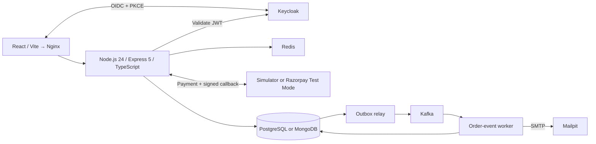

# Ecommerce platform

A full-stack ecommerce portfolio project. Shoppers can browse an active catalog,
pay the server-calculated price, and retrieve their own order confirmations.
Staff can maintain the catalog and track orders. The system handles repeated
payment callbacks and retries background delivery so an email failure does not
undo a paid order.

| Customer | Administrator |
| --- | --- |
| Browse products, inspect details, manage a persistent cart, and check out | Manage categories, prices, stock, images and product status, and import products by CSV |
| Sign in with Keycloak, view owned orders, download invoice and receipt PDFs, and track read/unread notifications | Access role-scoped catalog and order views |

## Architecture



- **Data.** PostgreSQL uses parameterized SQL via `pg`, versioned migrations and a transactional outbox table. MongoDB uses indexed collections and atomically records the paid transition and outbox intent on the order document. One backend is selected through Compose configuration.
- **Payments and delivery.** The simulator is the default for local checkout. Razorpay Test Mode is an optional provider with checkout verification and signed webhooks. The relay publishes to Kafka, and the worker deduplicates the durable notification, tracks email delivery, and routes failed events through retry or dead-letter topics. PDFKit generates documents, and Mailpit captures local email.
- **Access and performance.** Keycloak issues access tokens. The API verifies the signature, issuer and audience, enforces management roles, and scopes customer records to the token subject. Redis supports product caching and rate limits.

[Detailed architecture and payment-to-email flow](docs/architecture.md) · [Interview walkthrough and four-minute demo script](docs/interview-walkthrough.md)

## Docker quick start

Use Docker Engine with the Compose plugin (including `up --wait`) and Python 3. Run these commands from the repository root. The generator writes a private, ignored `infra/.env` from the same settings documented in [infra/.env.example](infra/.env.example). It refuses to overwrite an existing file. Keep the same credentials for the lifetime of the local volumes.

```sh
python3 scripts/prepare-ci-env.py --database ecommerce_dev
docker compose --env-file infra/.env -f infra/compose.yaml up -d --build --wait
```

Open the [storefront](http://localhost:8088), [API docs](http://127.0.0.1:3001/docs/), [Keycloak console](http://127.0.0.1:8180/admin/) or [Mailpit inbox](http://127.0.0.1:8025). Use `localhost:8088` for the browser because the realm registers that exact origin. The catalog starts empty. Sign up through the storefront to exercise the customer flow. Use the locally generated Keycloak administrator credentials to manage users and roles. To open the app’s Operations dashboard, assign a disposable staff user the `admin` client role on `ecommerce-api`, then sign in as that user.

To load the bundled sample catalog, use Node.js 24 and run the insert-only seed after Compose is ready.

```sh
(cd apps/api && npm ci)
node scripts/local/seed-catalog.mjs postgres
```

PostgreSQL is the default. To run MongoDB-backed business storage, set `ORDER_STORAGE=mongodb` in `infra/.env`, repeat the Compose start command, and run the seed with `mongodb`. Each backend retains its own data. Compose starts both database services in either mode, and the migration service uses PostgreSQL. Stop the local stack with `docker compose --env-file infra/.env -f infra/compose.yaml stop` to retain its volumes.

## Screenshots

Real local Chromium captures using the bundled sample catalog and disposable
demo accounts.


| Shopping | Checkout and follow-up | Operations |
| --- | --- | --- |
| [Product details](docs/screenshots/product-detail.png) · [Cart](docs/screenshots/cart.png) | [Checkout](docs/screenshots/checkout.png) · [Orders](docs/screenshots/orders.png) · [Notifications](docs/screenshots/notifications.png) | [Administrator dashboard](docs/screenshots/admin-dashboard.png) |

## Testing and CI/CD

With the Node.js version in [`.nvmrc`](.nvmrc), run typecheck, build and tests
in both apps.

```sh
(cd apps/api && npm ci && npm run typecheck && npm run build && npm test)
(cd apps/web && npm ci && npm run typecheck && npm run build && npm test)
```

GitHub Actions builds the Compose images, starts real PostgreSQL, MongoDB,
Keycloak, Redis, Kafka and Mailpit, then runs the full host integration suite
against `ecommerce_test`. It runs the Compose HTTP/payment/event smoke for
both persistence backends. Run the host suite against infrastructure only,
before starting the application workers on the test database. Cloud deployment
workflows are separate. [Verification results and CI reproduction](docs/recruiter-showcase.md)

## Security decisions and known limitations

- The SPA uses Authorization Code with PKCE and keeps access tokens in memory. Keycloak revocation blocks refresh. A bearer already issued can remain valid for its five-minute lifetime plus five seconds of clock tolerance.
- The API prices and validates stock from the catalog. Real sales still require stock reservation and atomic inventory updates to prevent concurrent overselling.
- The simulator supports local success and failure without real charges. Actual Razorpay Test Mode capture and Razorpay-delivered public HTTPS webhook verification are pending. [Razorpay configuration](docs/milestone-2a-razorpay.md)
- Mailpit confirms local SMTP acceptance. Ambiguous external acceptance requires reconciliation by stable Message-ID before any replay. [SMTP reconciliation](docs/milestone-3-reliability-security.md#payment-and-delivery-reliability)
- Compose is a loopback development stack with HTTP and a single Kafka broker. See the [showcase report](docs/recruiter-showcase.md) for Kafka timing evidence, hosted CI status and remaining release gates.
