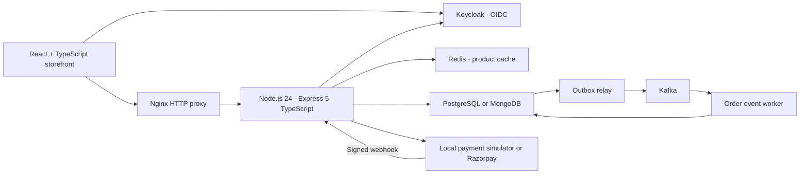
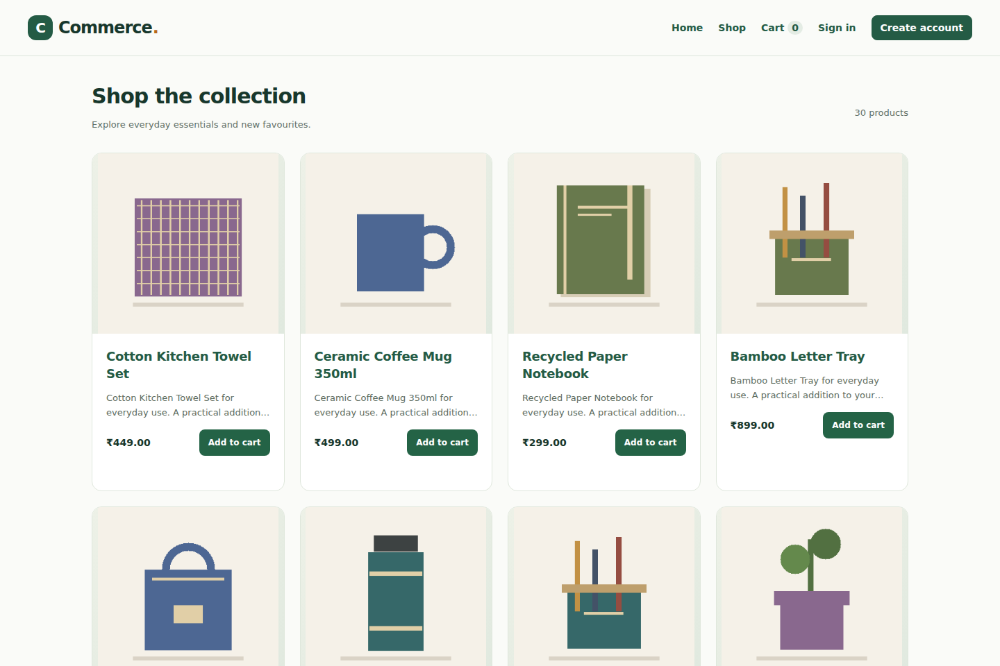
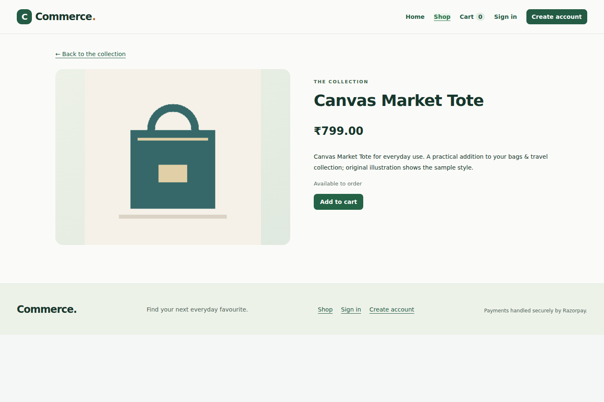

# Ecommerce platform

A full-stack ecommerce project for exploring authenticated checkout, interchangeable persistence and reliable event delivery. The React storefront includes product browsing, a cart and order history. The Express API also exposes role-protected catalog management.

## Architecture



Routes validate requests before handing off to controllers and services. Repository interfaces isolate persistence. PostgreSQL adapters use parameterized SQL and versioned migrations. MongoDB adapters use indexed collections and an embedded order outbox. The backend selector applies to the catalog, orders, payment state and event processing. Redis caches product reads, with invalidation on writes. Kafka carries payment-completed events from the outbox relay to the notification worker. Mailpit is available for local email testing.

| Directory | Contents |
| --- | --- |
| [apps/web](apps/web) | React, TypeScript and Vite, served by Nginx in Compose |
| [apps/api](apps/api) | Express API, repositories, migrations and workers |
| [services/payment-provider-simulator](services/payment-provider-simulator) | Local payment simulator with signed callbacks |
| [infra](infra) | Docker Compose, Keycloak realm and optional cloud infrastructure |

## Docker quick start

Use Docker Engine with the Compose plugin (including `up --wait`) and Python 3. Run these commands from the repository root. The generator writes a private, ignored `infra/.env` from the same settings documented in [infra/.env.example](infra/.env.example). It refuses to overwrite an existing file. Keep the same credentials for the lifetime of the local volumes.

```sh
python3 scripts/prepare-ci-env.py --database ecommerce_dev
docker compose --env-file infra/.env -f infra/compose.yaml up -d --build --wait
```

Open the [storefront](http://localhost:8088), [API docs](http://127.0.0.1:3001/docs/), [Keycloak console](http://127.0.0.1:8180/admin/) or [Mailpit inbox](http://127.0.0.1:8025). Use `localhost:8088` for the browser because the realm registers that exact origin. The catalog starts empty. Sign up through the storefront to exercise the customer flow. Use the locally generated Keycloak administrator credentials to manage users and roles.

To load the bundled sample catalog, use Node.js 24 and run the insert-only seed after Compose is ready.

```sh
(cd apps/api && npm ci)
node scripts/local/seed-catalog.mjs postgres
```

PostgreSQL is the default. To run MongoDB-backed business storage, set `ORDER_STORAGE=mongodb` in `infra/.env`, repeat the Compose start command, and run the seed with `mongodb`. Each backend retains its own data. Compose starts both database services in either mode, and the migration service uses PostgreSQL. Stop the local stack with `docker compose --env-file infra/.env -f infra/compose.yaml stop` to retain its volumes.

## Screenshots

The storefront and product detail below use the repository’s synthetic catalog.





## Verification

Use the Node.js version in [.nvmrc](.nvmrc).

```sh
(cd apps/api && npm ci && npm run typecheck && npm run build && npm test)
(cd apps/web && npm ci && npm run typecheck && npm run build && npm test)
```

The integration suite uses real PostgreSQL, MongoDB, Keycloak, Redis and Kafka.
With the development services running, use `python3 scripts/run-compose-integration.py`
from the root. The runner targets `ecommerce_test` and exercises both backends.

To reproduce the CI sequence, use a disposable checkout with the default ports
available. Use a separate Docker host or context if the development stack is
running on those ports. Run the host suite before starting the application relay
and worker so they cannot claim its fixture events.

```sh
(cd apps/api && npm ci)
python3 scripts/prepare-ci-env.py
docker compose -f infra/compose.yaml config --quiet
docker compose -f infra/compose.yaml build
docker compose -f infra/compose.yaml up -d --wait postgres mongodb redis-cache kafka keycloak
python3 scripts/run-compose-integration.py
docker compose -f infra/compose.yaml up -d --wait
python3 scripts/verify-compose.py
ORDER_STORAGE=mongodb docker compose -f infra/compose.yaml up -d --wait
ORDER_STORAGE=mongodb python3 scripts/verify-compose.py
docker compose -f infra/compose.yaml stop
```

See the [readiness report](docs/recruiter-readiness.md) for the GitHub Actions failure, verification evidence and seven cloud test prerequisites.

## Security model and limitations

- The storefront uses Keycloak Authorization Code with PKCE. The API validates JWT signature, issuer and audience. Public storefront reads expose active catalog items. Management routes require scoped roles, and customer order access is bound to the token subject.
- Checkout prices from the server-side catalog, checks stock and verifies signed payment callbacks. Payment processing and event consumption include idempotency checks. Stock validation currently provides no inventory reservation.
- Docker uses the local simulator by default. The development checkout can simulate success or failure with no external charge. The storefront footer currently shows Razorpay branding in both modes. Optional Razorpay setup requires separate credentials and webhook configuration. [Payment integration](docs/payment-integration.md), [API environment example](apps/api/.env.example).
- Compose is a local development stack with loopback ports, HTTP, development Keycloak and a single Kafka broker. Cloud integrations, public HTTPS, production operations and live payment certification remain outside this baseline. [Recruiter readiness](docs/recruiter-readiness.md).
