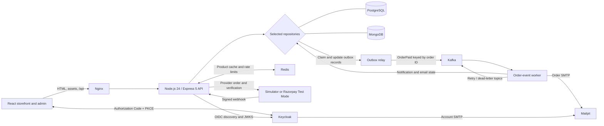

# Local architecture

The Compose baseline runs an Express modular monolith, a browser SPA, and separate
outbox and order-event workers built from the API image. One persistence backend
is selected per process using the shared Compose configuration.

## HTTP and persistence boundaries

Express routes apply access policy and Zod validation, then pass inputs through
controllers to services. Services own pricing and state transitions and depend
on repository interfaces. The composition root in
[`server.ts`](../apps/api/src/server.ts) selects database adapters and opens
resources. Central error handling normalizes failures. `/health` checks
liveness and `/ready` checks required persistence. Migrations are explicit.

| Concern | PostgreSQL | MongoDB |
| --- | --- | --- |
| Business data | Normalized tables, foreign keys, parameterized SQL via `pg`, numbered migrations | Indexed collections, embedded order lines, atomic document updates, comparable repository contracts |
| Paid transition | Payment receipt, order status, audit and outbox row commit in one transaction | Order status, canonical payment receipt and outbox commit in one order-document update. Audit and receipt collections are repairable projections |
| Relay claim | Row locking with `SKIP LOCKED` and a claim lease | Atomic `findOneAndUpdate` with a claim lease |

Catalog, orders, payment state, outbox and notification persistence follow the
selection. Compose starts both engines and runs PostgreSQL migrations, while
business writes go to the selected backend. [Raw SQL decision](decisions/001-postgresql-raw-sql.md) · [Module boundaries](decisions/002-modular-monolith.md)

## Order, payment, event and email

1. Checkout sends product IDs and quantities. The API resolves active products,
   combines repeated lines, validates current stock and snapshots server-priced
   line items. It persists an order and starts a provider payment. Provider
   retries reuse stable identifiers.
2. The simulator can issue a signed success or failure callback. Razorpay
   checkout verification checks the signature and provider state against the
   recorded payment, amount and currency. A valid captured webhook can also
   settle the order. Both Razorpay paths converge on the same deterministic
   payment event. Duplicate callbacks leave the paid order version stable.
3. The paid transition persists `OrderPaid` in the outbox. The relay polls and
   claims records, publishes to Kafka, and marks publication after broker
   acknowledgement. A crash between publish and acknowledgement can redeliver.
4. The worker persists an owner-scoped notification and tracks email delivery
   separately. It commits the Kafka offset after durable handling or after an
   acknowledged retry/dead-letter publication. The worker uses the order
   snapshot for confirmation email and PDF attachments. The API serves private
   invoice and paid receipt downloads. Local SMTP goes to Mailpit.
5. The customer can view orders and mark a notification as read. A definite
   SMTP failure before acceptance can retry. Ambiguous acceptance requires
   evidence-based reconciliation using the stable Message-ID.

[Payment integration](payment-integration.md) · [Transactional outbox](transactional-outbox.md) · [Kafka contracts](kafka-order-events.md) · [SMTP reconciliation](milestone-3-reliability-security.md#payment-and-delivery-reliability)
